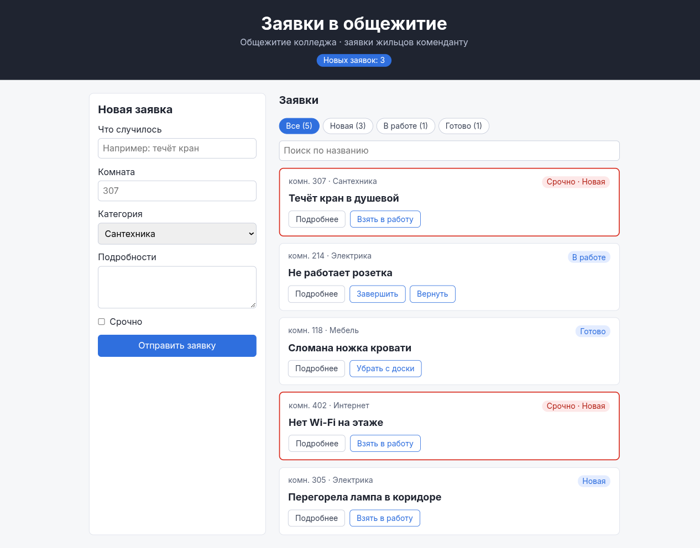
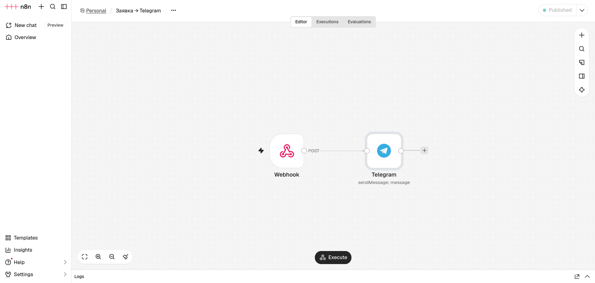
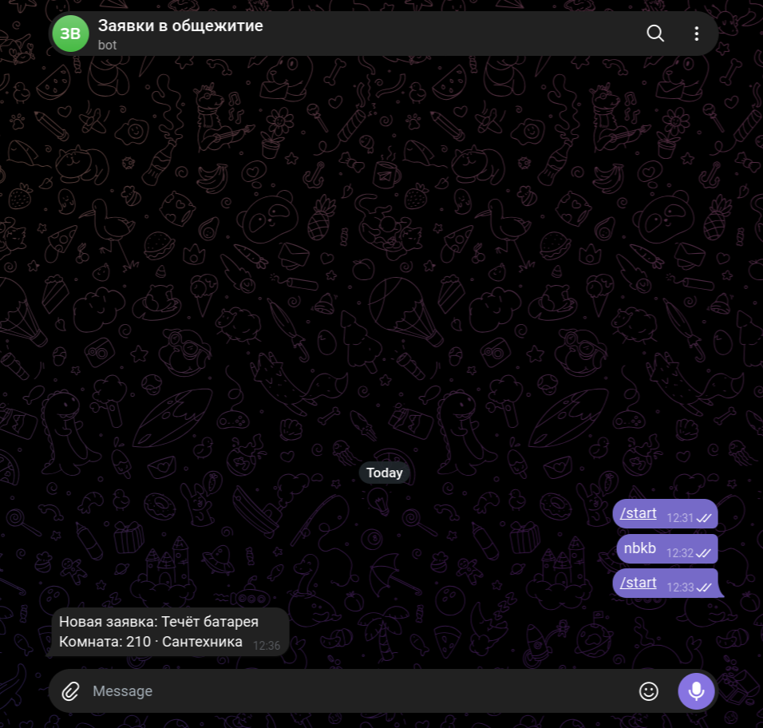
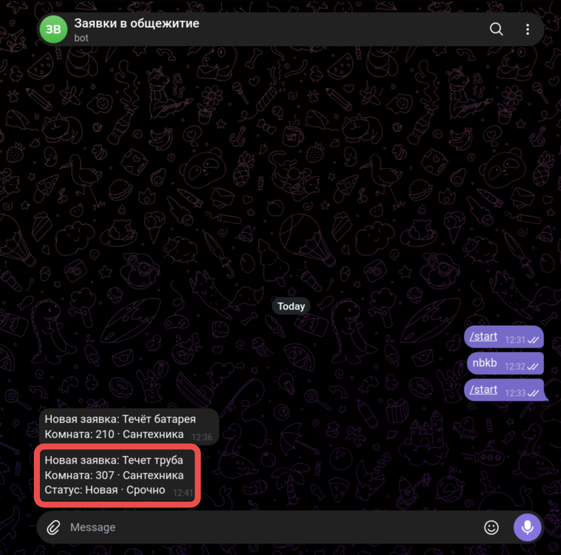

# Заявки в общежитие

Доска заявок для общежития колледжа. Жильцы оставляют заявки о поломках, комендант ведёт их по статусам. О каждой новой заявке приходит уведомление в Telegram через n8n.

Сделано на React + TypeScript + Vite.



## Что умеет

- **Новая заявка.** Форма с полями «Что случилось», «Комната», «Категория» (Сантехника, Электрика, Мебель, Интернет), «Подробности» и отметкой «Срочно». Без названия и номера комнаты заявка не отправится.
- **Статусы.** Заявка проходит путь «Новая» → «В работе» → «Готово». Заявку «В работе» можно вернуть в «Новая», а готовую — убрать с доски.
- **Фильтр и поиск.** Кнопки фильтра по статусу показывают число заявок в каждом. Поиск ищет по названию.
- **Срочные заявки** выделены красной рамкой. В шапке показано, сколько заявок в статусе «Новая».
- **Подробности** заявки раскрываются по кнопке «Подробнее».
- **Сохранение.** Заявки хранятся в `localStorage`, после перезагрузки страницы они остаются на месте.
- **Заголовок вкладки** показывает число новых заявок: «Новых: 3 · Доска заявок».
- **Сообщения** над списком («Заявка добавлена…») исчезают сами через 5 секунд.
- **Клавиша Esc** сбрасывает фильтр на «Все».

## Уведомления в Telegram

После добавления заявки приложение отправляет её POST-запросом на вебхук n8n `http://localhost:5678/webhook/zayavka` (`src/notify.ts`). Сценарий n8n из двух узлов, Webhook и Telegram, пересылает заявку боту:



Сообщение от бота в Telegram:



В уведомлении указаны статус заявки и отметка «Срочно»:



Если n8n не запущен, заявка всё равно сохраняется на доске, а приложение пишет, что уведомление не отправлено.

## Запуск

```bash
npm install
npm run dev
```

Приложение откроется на http://localhost:5173. Порт менять нельзя: вебхук n8n принимает запросы только с этого адреса.

## Запуск n8n

Без n8n доска тоже работает, но уведомления в Telegram приходить не будут. Для n8n нужен установленный Docker.

1. **Запустите n8n** из папки `server/` (вместе с ним запустится и PocketBase, см. ниже):

   ```bash
   cd server
   docker compose up -d --build
   ```

   Откройте http://localhost:5678. При первом запуске n8n попросит создать аккаунт владельца, он хранится только на вашем компьютере.

2. **Создайте бота в Telegram.** Напишите [@BotFather](https://t.me/BotFather) команду `/newbot`, придумайте имя и сохраните токен, который он пришлёт. Затем откройте своего бота и нажмите «Start».

3. **Узнайте свой Chat ID.** Откройте в браузере `https://api.telegram.org/bot<токен>/getUpdates`, подставив токен бота. Chat ID — это число в поле `"chat": {"id": ...}`.

4. **Импортируйте сценарий.** В n8n создайте новый workflow, в меню `⋯` выберите **Import from File** и укажите `server/zayavka-telegram.json`.

5. **Настройте узел Telegram.** Откройте его двойным щелчком:
   - в **Credential** выберите **Create new credential** и вставьте токен бота;
   - в **Chat ID** вставьте число из шага 3.

6. **Опубликуйте сценарий** кнопкой **Publish** в правом верхнем углу. Без публикации адрес `/webhook/zayavka` не работает.

Теперь добавьте заявку на доске: через пару секунд бот пришлёт уведомление.

Остановить n8n и PocketBase:

```bash
cd server
docker compose down
```

Сценарии и аккаунт сохраняются в томе Docker `n8n_data`, поэтому при следующем запуске их не придётся настраивать заново.

## База данных PocketBase

Чтобы заявки видели все, а не только один браузер, они будут храниться на сервере [PocketBase](https://pocketbase.io). Доска к нему пока не подключена и работает с `localStorage`.

PocketBase 0.40.6 запускается в Docker той же командой, что и n8n: образ собирается по `server/pocketbase/Dockerfile`, база хранится в томе `pb_data`. API открывается на http://localhost:8090, панель администратора на http://localhost:8090/_/.

1. **Создайте администратора** (пароль не короче 8 символов):

   ```bash
   cd server
   docker compose exec pocketbase /pb/pocketbase superuser upsert ПОЧТА ПАРОЛЬ --dir=/pb/pb_data
   ```

2. **Создайте коллекцию `requests`** (тип Base) с полями, как у `RequestItem`:

   | Поле | Тип | Обязательное | Варианты |
   |------|-----|--------------|----------|
   | title | Plain text | да | — |
   | room | Plain text | да | — |
   | category | Select | да | Сантехника, Электрика, Мебель, Интернет |
   | details | Plain text | нет | — |
   | urgent | Bool | нет | — |
   | status | Select | да | Новая, В работе, Готово |

3. **Настройте правила доступа** (шестерёнка у коллекции → API rules):

   | Правило | Условие | Смысл |
   |---------|---------|-------|
   | List/Search, View | пусто | читать могут все |
   | Create | `@request.body.status = "Новая"` | нельзя создать заявку сразу готовой |
   | Update | `@request.body.title:isset = false && @request.body.room:isset = false && @request.body.details:isset = false && @request.body.urgent:isset = false` | менять можно только статус и категорию |
   | Delete | `status = "Готово"` | удалить можно только готовую заявку |

Проверка: http://localhost:8090/api/collections/requests/records возвращает список заявок. Запрос на создание заявки со статусом «Готово» получает ответ 400, попытка изменить название или удалить незавершённую заявку — 404.

## Структура

```
server/
  compose.yaml           — запуск n8n и PocketBase в Docker
  pocketbase/Dockerfile  — образ PocketBase
  zayavka-telegram.json  — сценарий «Заявка → Telegram» для импорта
src/
  App.tsx              — доска: список, фильтр, поиск, смена статусов, эффекты
  components/
    Header.tsx         — шапка со счётчиком новых заявок
    RequestForm.tsx    — форма новой заявки
    RequestCard.tsx    — карточка заявки
  requests.ts          — типы, начальные заявки, переходы статусов
  storage.ts           — сохранение в localStorage
  notify.ts            — отправка заявки в n8n
```
