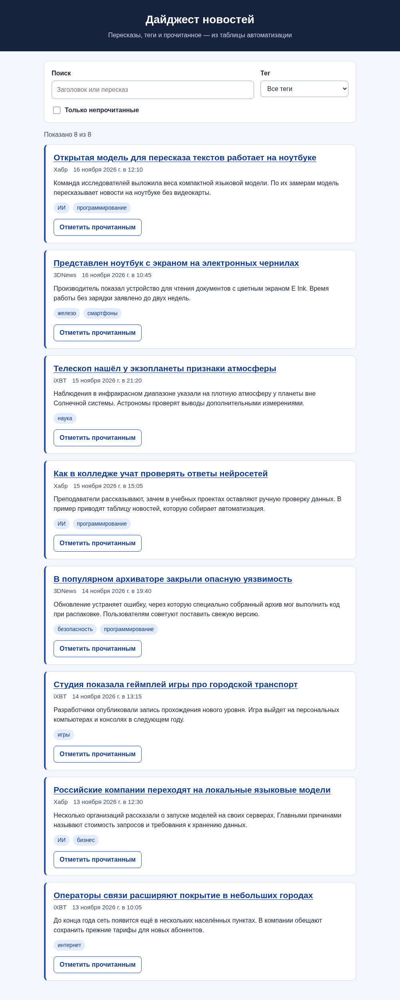
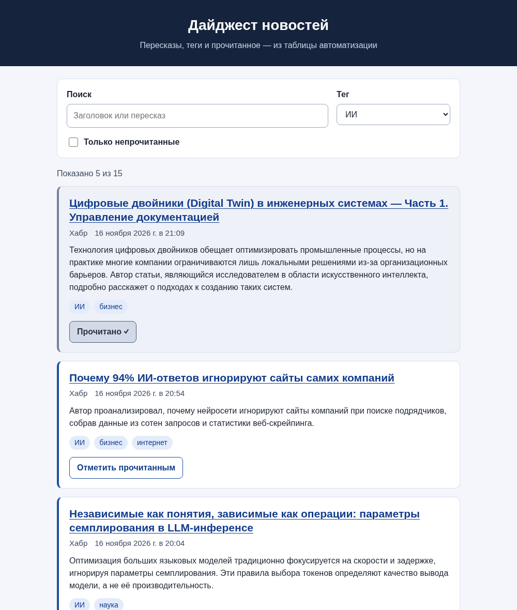
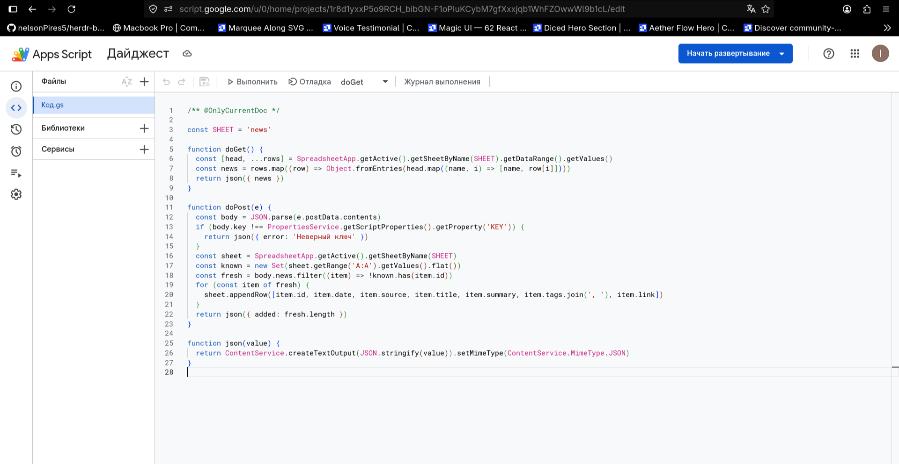
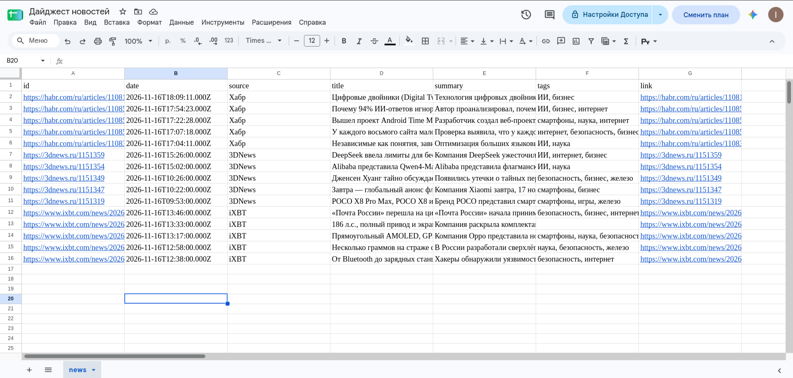
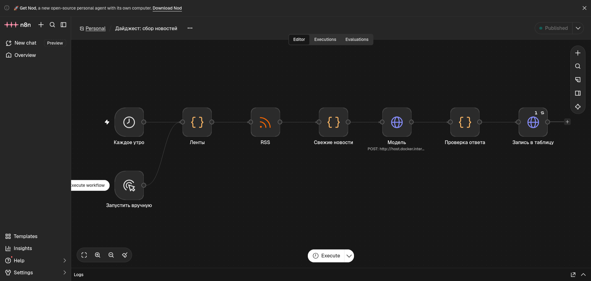
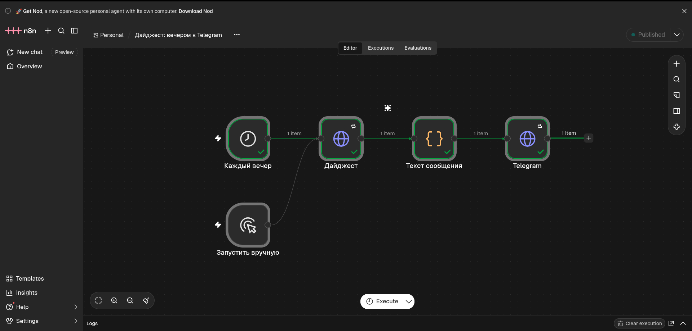
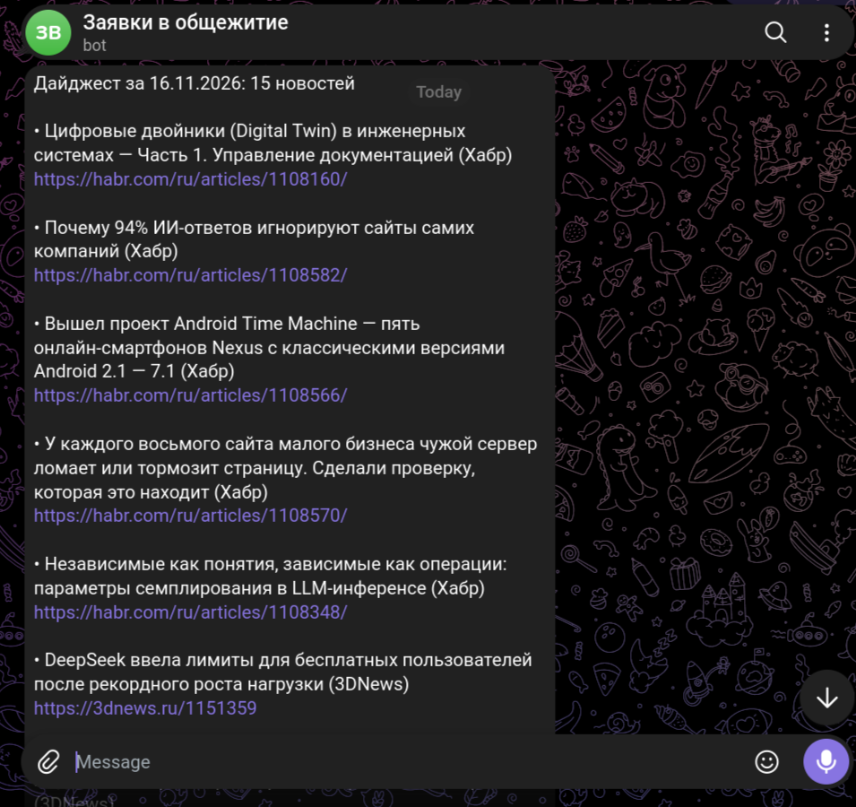
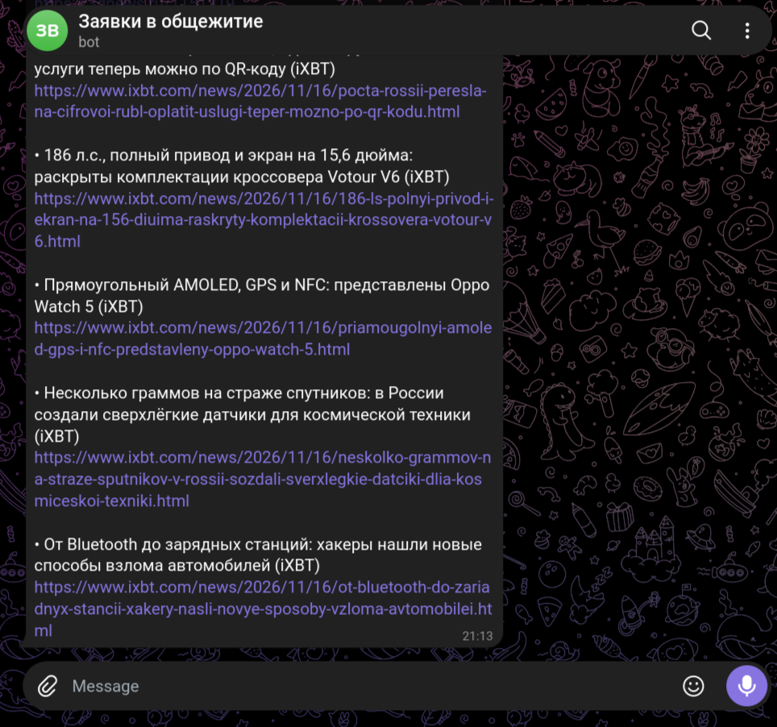
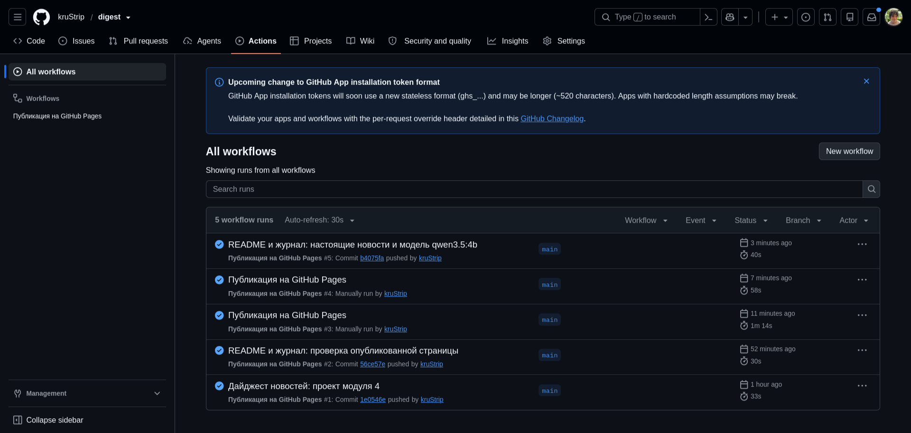

# Дайджест новостей · проект модуля 4

Страница к автоматизации модуля 4: читает новости, которые n8n каждое утро собирает
в Google Таблицу, и показывает их лентой карточек. Поиск, фильтр по тегу, отметка
«прочитано» — всё работает без сервера, в браузере.

| | |
|---|---|
| Репозиторий | [github.com/kruStrip/digest](https://github.com/kruStrip/digest) |
| Сайт | [kruStrip.github.io/digest](https://krustrip.github.io/digest/) |
| Задание | [проект модуля 4](https://maximbytecamp.github.io/angular_react_makarov/temy/49-proekt-daydzhest/index.html) |
| Автоматизация | [сбор новостей и вечерний дайджест](https://maximbytecamp.github.io/angular_react_makarov/temy/48-avtomatizaciya/index.html) |



Фильтр по тегу «ИИ» и прочитанная новость: карточка бледнее, на кнопке «Прочитано ✓».



## Обязательные требования

| Требование | Где выполнено |
|---|---|
| Vite, React 19, TypeScript; адрес в `VITE_DIGEST_URL`, строкой в коде его нет | `package.json`, `.env.example`, `src/App.tsx` |
| Заголовок — ссылка в новой вкладке, источник, дата и время, пересказ, теги метками | `src/App.tsx`, `src/index.css` |
| Новости от свежих к старым | `sortNews` в `src/digest.ts` |
| Поиск по заголовку и пересказу без регистра, один тег, «только непрочитанные», всё вместе | `src/App.tsx` — фильтр считается при отрисовке |
| «Прочитано» снимается повторным нажатием и хранится в `localStorage` | `src/read.ts`, ключ `digest-read` |
| `role="status"` при загрузке, `role="alert"` с кодом при ошибке, «Новостей не найдено» | `src/App.tsx` |
| Не меньше пяти тестов с подменённой сетью | `src/App.test.tsx` (7), `src/digest.test.ts` (4) |
| Lighthouse Accessibility — 100, подписи полей, работа с клавиатуры | `src/App.tsx`, `src/index.css`; замер — 100 |
| `AGENTS.md` с правилами проекта | `AGENTS.md` |
| Не меньше трёх заданий агенту с «Готово, когда» и записями в журнале | `tasks/01`…`04`, `ai-log.md` |
| GitHub Pages; в конвейере линтер `--deny-warnings` и тесты до сборки | `.github/workflows/deploy.yml` |
| Процессы n8n автоматизации работают | `../avtomatizaciya/digest/` |

## Как выполнено задание

Снимки сделаны 16.11.2026 на рабочей версии: страница читает Google Таблицу, а не
демонстрационный файл. Пять свежих новостей с каждого источника собирает утренний
процесс n8n, вечером тот же набор уходит сообщением в Telegram.

**Данные.** `doGet` в Apps Script отдаёт лист `news` как JSON, `doPost` принимает
новости от n8n и пропускает уже знакомые `id`:



После утреннего запуска в таблице 15 строк — по пять новостей с Хабра, 3DNews и iXBT:



**Автоматизация.** Утренний процесс собирает RSS, оставляет новости за последние
сутки, пересказывает каждую моделью и пишет результат в таблицу:



Вечерний процесс читает таблицу, собирает текст и отправляет его в Telegram:



Сообщение приходит одним текстом: дата, число новостей, заголовки и ссылки.





**Публикация.** Конвейер GitHub Actions прогоняет линтер с `--deny-warnings`, тесты
и сборку, затем публикует сайт:



## Данные

`VITE_DIGEST_URL` возвращает JSON веб-приложения Apps Script:

```json
{"news": [{"id": "…", "date": "2026-11-16T09:10:00Z", "source": "Хабр",
           "title": "…", "summary": "…", "tags": "ИИ, наука", "link": "…"}]}
```

Сайт читает настоящий адрес Apps Script из `VITE_DIGEST_URL`: локально — из `.env`,
на GitHub Pages — из переменной репозитория **Settings → Secrets and variables →
Actions → Variables**. Код при смене адреса не меняется. Если переменная не задана,
сборка подставляет `public/data/news.json` — демонстрационный набор в том же формате
(8 новостей, источники Хабр, 3DNews, iXBT), чтобы страница не осталась пустой.

Ключ записи в таблицу странице не нужен: он остаётся в n8n.

## Запуск

```bash
npm install
cp .env.example .env     # вписать адрес веб-приложения
npm run dev              # http://localhost:5173/digest/
```

`base: '/digest/'` в `vite.config.ts` совпадает с адресом на GitHub Pages, поэтому
страница открывается по тому же пути, что и на сайте.

Проверки:

```bash
npx tsc -b
npm run lint -- --deny-warnings
CI=true npm test
npm run build
```

Для замера Lighthouse:

```bash
npm run dev
npx lighthouse@12 http://localhost:5173/digest/ --only-categories=accessibility --view
```

Результат на этой странице: Accessibility **100**, ошибок в консоли браузера нет,
Tab проходит поиск, тег, флажок, ссылки и кнопки, фокус виден. На опубликованной
странице Lighthouse 12 тоже даёт **100**: 8 карточек, тег «ИИ» → 3 из 8, отметка
«прочитано» переживает F5.

Конвейер на GitHub прогоняет линтер и тесты до сборки и публикует `dist` на Pages:
[runs](https://github.com/kruStrip/digest/actions).

## Структура

```
.github/workflows/deploy.yml — линтер, тесты, сборка и публикация на Pages
public/data/news.json        — демонстрационные новости в формате таблицы
screenshots/                 — лента, фильтр и снимки конвейера
tasks/                       — задания агенту с разделом «Готово, когда»
src/
  App.tsx                    — лента, фильтры, счётчик, состояния
  digest.ts                  — загрузка, разбор тегов, сортировка
  read.ts                    — прочитанное в localStorage
  App.test.tsx               — 7 тестов страницы с подменённым fetch
  digest.test.ts             — 4 теста загрузки и разбора
AGENTS.md                    — правила проекта для агента
ai-log.md                    — журнал: задания, проверки, решения
```

