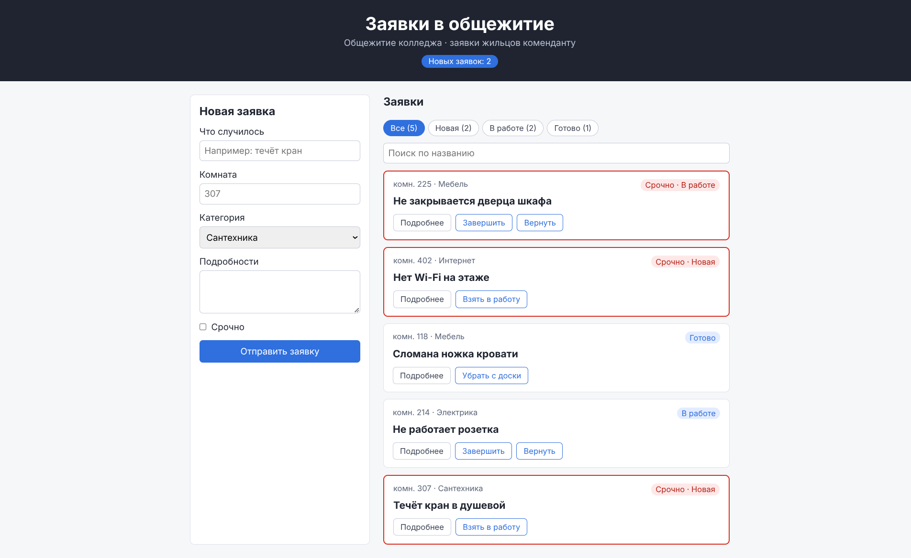
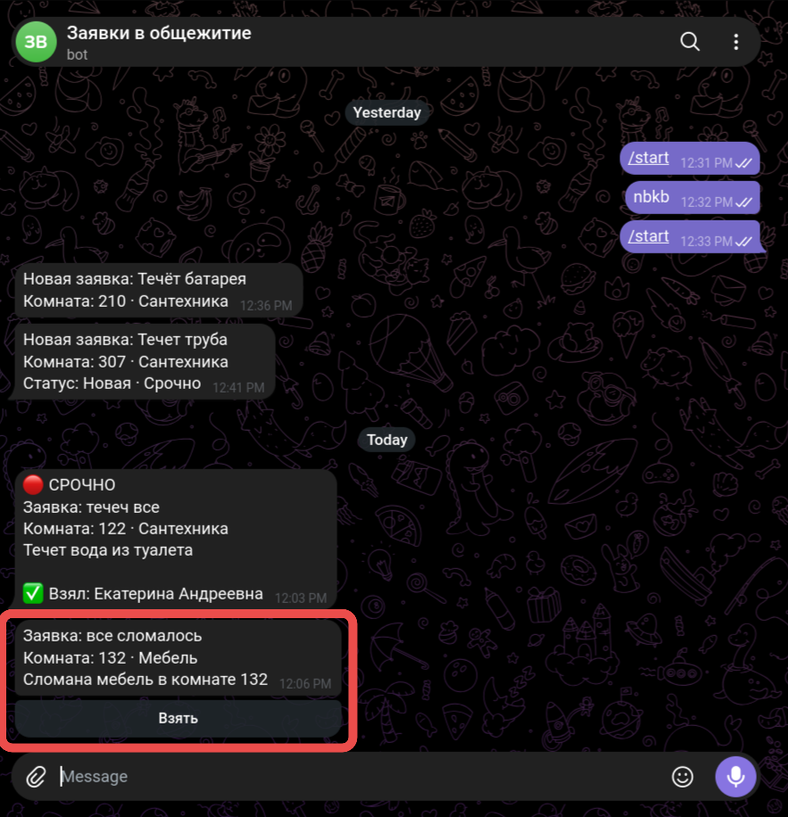
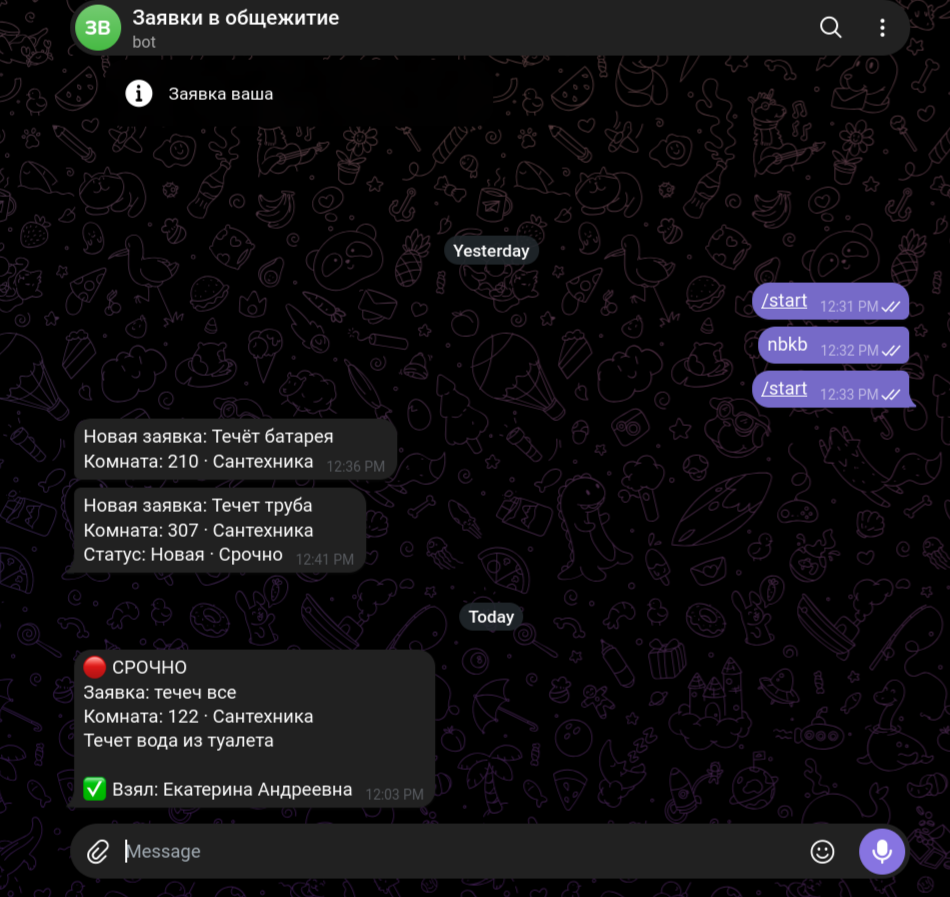

# Заявки в общежитие

Доска заявок для общежития колледжа. Жильцы оставляют заявки о поломках, комендант ведёт их по статусам. Заявки хранятся на сервере PocketBase в коллекции `obshchezhitie`, поэтому все окна и браузеры видят одни и те же заявки. Новую заявку разбирает ИИ-диспетчер в n8n: модель qwen2.5:3b определяет категорию и срочность, а мастеру приходит сообщение в Telegram с кнопкой «Взять».

Сделано на React + TypeScript + Vite.



## Что умеет

- **Новая заявка.** Форма с полями «Что случилось», «Комната», «Категория» (Сантехника, Электрика, Мебель, Интернет), «Подробности» и отметкой «Срочно». Без названия и номера комнаты заявка не отправится.
- **Статусы.** Заявка проходит путь «Новая» → «В работе» → «Готово». Заявку «В работе» можно вернуть в «Новая», а готовую — убрать с доски.
- **Фильтр и поиск.** Кнопки фильтра по статусу показывают число заявок в каждом. Поиск ищет по названию.
- **Срочные заявки** выделены красной рамкой. В шапке показано, сколько заявок в статусе «Новая».
- **Подробности** заявки раскрываются по кнопке «Подробнее».
- **Сервер.** Список загружается из PocketBase, пока его нет — надпись «Загрузка заявок…». Добавление, смена статуса и удаление отправляются на сервер и сохраняются после F5.
- **Ошибка загрузки.** Если PocketBase не отвечает, на доске сообщение и кнопка «Повторить».
- **Обновление без F5.** Доска подписана на события коллекции: заявка, добавленная в другом окне, смена статуса кнопкой «Взять» в Telegram или правка категории в панели PocketBase появляются сразу.
- **Заголовок вкладки** показывает число новых заявок: «Новых: 3 · Доска заявок».
- **Сообщения** над списком («Заявка добавлена…») исчезают сами через 5 секунд.
- **Клавиша Esc** сбрасывает фильтр на «Все».

## Запуск

Нужны Node.js и Docker. Сначала сервер (из папки `server/` или `avtomatizaciya/`):

```bash
docker compose up -d
```

Затем доска:

```bash
npm install
npm run dev
```

Приложение откроется на http://localhost:5173. Порт менять нельзя: вебхук n8n принимает запросы только с этого адреса.

## База данных PocketBase

PocketBase 0.40.6 запускается в Docker: образ собирается по `server/pocketbase/Dockerfile`, база хранится в томе `pb_data`. API — http://localhost:8090, панель администратора — http://localhost:8090/_/.

1. **Создайте администратора**, если его ещё нет (пароль не короче 8 символов):

   ```bash
   docker compose exec pocketbase /pb/pocketbase superuser upsert ПОЧТА ПАРОЛЬ --dir=/pb/pb_data
   ```

2. **Создайте коллекцию `obshchezhitie`.** Проще всего импортом: в панели **Settings → Import collections → Load from JSON file** выберите `server/pb-obshchezhitie.json`, затем **Review → Confirm**. Поля коллекции:

   | Поле | Тип | Обязательное | Варианты |
   |------|-----|--------------|----------|
   | title | Plain text | да | — |
   | room | Plain text | да | — |
   | category | Select | да | Сантехника, Электрика, Мебель, Интернет |
   | details | Plain text | нет | — |
   | urgent | Bool | нет | — |
   | status | Select | да | Новая, В работе, Готово |

3. **Правила доступа** (уже есть в файле импорта):

   | Правило | Условие | Смысл |
   |---------|---------|-------|
   | List/Search, View | пусто | читать могут все |
   | Create | `@request.body.status = "Новая"` | нельзя создать заявку сразу готовой |
   | Update | `@request.body.title:isset = false && @request.body.room:isset = false && @request.body.details:isset = false` | чужие тексты менять нельзя, статус и категорию — можно |
   | Delete | `status = "Готово"` | удалить можно только готовую заявку |

4. **Добавьте заявки** — не меньше пяти, разных статусов.

Проверка: http://localhost:8090/api/collections/obshchezhitie/records возвращает список заявок. Запрос на создание заявки со статусом «Готово» получает ответ 400, попытка изменить название или удалить незавершённую заявку — 404.

Если остановить PocketBase (`docker compose stop pocketbase`) и обновить доску, появится сообщение и кнопка «Повторить». После `docker compose start pocketbase` кнопка загружает список.

## ИИ-диспетчер в n8n

После добавления заявки доска отправляет её (уже с id из PocketBase) на вебхук `http://localhost:5678/webhook/zayavka` (`src/notify.ts`). Дальше работают два процесса n8n:

- **«ИИ-диспетчер»** (`server/ii-dispetcher.json`): Webhook → Модель (Ollama, qwen2.5:3b, ответ по JSON-схеме: категория из четырёх своих, срочность, краткое описание) → Ответ модели → Категория в базу (PATCH в `obshchezhitie`) → Telegram (сообщение с кнопкой «Взять»).
- **«Кнопка «Взять»»** (`server/knopka-vzyat.json`): раз в 10 секунд забирает нажатия кнопок методом `getUpdates`, переводит заявку в «В работе» и дописывает в сообщение «✅ Взял: имя». Доска показывает новый статус по подписке, без F5.

Настройка:

1. **Токен бота.** Создайте файл `.env` рядом с `compose.yaml` по образцу `.env.example`: `TELEGRAM_TOKEN=токен-от-BotFather`. Файл не попадает в Git и в архив сдачи. После создания выполните `docker compose up -d`.
2. **Модель.** `docker compose exec ollama ollama pull qwen2.5:3b`, проверка — `docker compose exec ollama ollama list`. Ollama из Docker открыта на порту 11435 (11434 часто занят Ollama, установленной в системе); n8n обращается к ней внутри Docker по адресу `http://ollama:11434`.
3. **Процессы.** В n8n снимите с публикации процесс модуля 1 «Заявка → Telegram» (Unpublish): адрес `/webhook/zayavka` может слушать только один процесс. Создайте два новых процесса и импортируйте в них `server/ii-dispetcher.json` и `server/knopka-vzyat.json` (`⋯` → **Import from File**).
4. В узле **Telegram** процесса «ИИ-диспетчер» выберите учётные данные бота и впишите Chat ID. В процессе «Кнопка «Взять»» проверьте учётные данные у двух узлов Telegram.
5. Опубликуйте оба процесса (**Publish**).

Сообщение бота с кнопкой «Взять» (внизу): категорию и описание написала модель:



Сообщение бота после нажатия «Взять»: срочность и описание от модели, внизу — кто взял заявку. На доске эта заявка уже «В работе»:



Модель ошибается: её категория — подсказка. Неверную категорию комендант исправляет в панели PocketBase, доска покажет исправление сразу.

## Структура

```
server/
  compose.yaml           — запуск n8n, PocketBase и Ollama в Docker
  pocketbase/Dockerfile  — образ PocketBase
  pb-obshchezhitie.json  — коллекция obshchezhitie с правилами для импорта в PocketBase
  ii-dispetcher.json     — процесс n8n «ИИ-диспетчер»
  knopka-vzyat.json      — процесс n8n «Кнопка «Взять»»
  zayavka-telegram.json  — сценарий модуля 1 «Заявка → Telegram»
src/
  App.tsx              — экран доски: фильтр, поиск, сообщения, эффекты
  components/
    Header.tsx         — шапка со счётчиком новых заявок
    RequestForm.tsx    — форма новой заявки
    RequestCard.tsx    — карточка заявки
  useRequests.ts       — хук: загрузка, ошибка, повтор, подписка, действия с заявками
  api.ts               — запросы к PocketBase
  realtime.ts          — подписка на события коллекции
  requests.ts          — типы, переходы статусов, upsertRequest
  notify.ts            — отправка заявки в n8n
```
