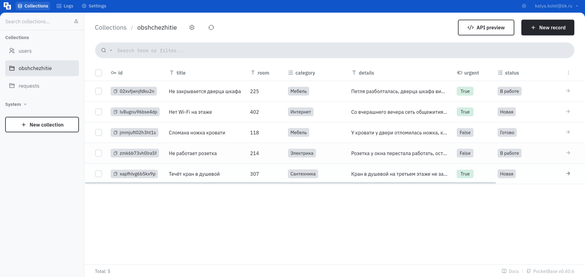
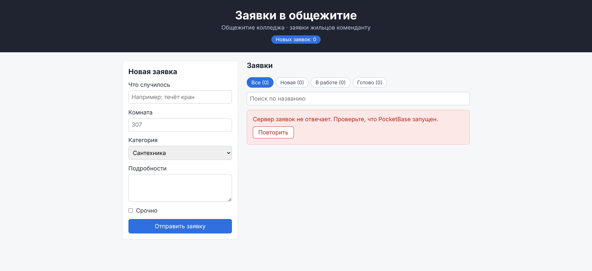
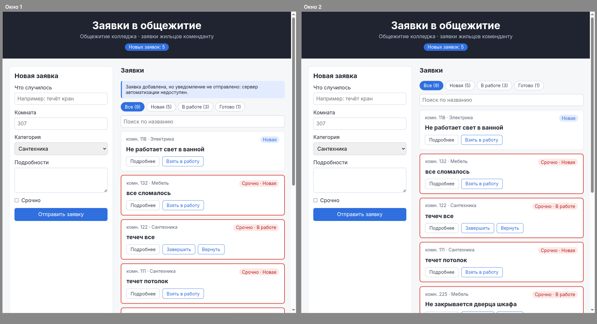
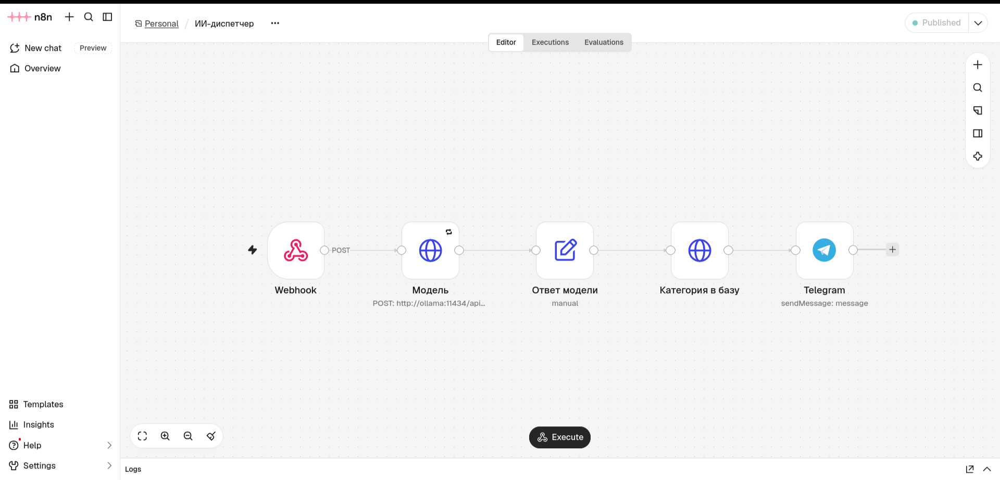
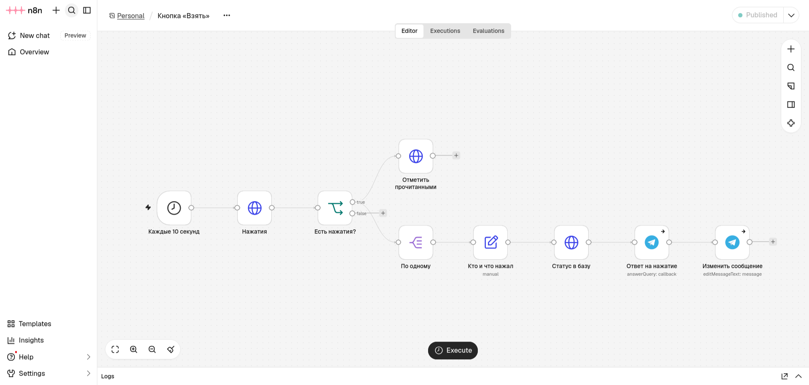
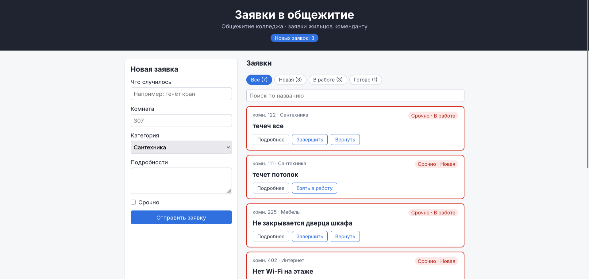

# Заявки в общежитие · проект модуля 2

Доска заявок для общежития колледжа (вариант «Общежитие»). Жильцы оставляют заявки о поломках, комендант ведёт их по статусам «Новая» → «В работе» → «Готово».

В проекте модуля 1 заявки хранились в `localStorage` одного браузера. В модуле 2 доска переехала на сервер:

| Что | Модуль 1 | Модуль 2 |
|-----|----------|----------|
| Где хранятся заявки | `localStorage` | коллекция `obshchezhitie` в PocketBase |
| Кто что может | любой — что угодно | правила коллекции |
| Начало работы | список готов сразу | загрузка, ошибка с кнопкой «Повторить», список |
| Код работы с данными | в `App.tsx` | в хуке `useRequests` |
| Изменения из другого окна | не видны | появляются без F5 |
| Уведомление | текст заявки в Telegram | категория и срочность от модели, кнопка «Взять» |

Сделано на React + TypeScript + Vite, сервер — PocketBase 0.40.6, автоматизация — n8n 2.45.4 и Ollama с моделью qwen2.5:3b в Docker.


## Как выполнены требования

### 1. Шапка, форма, карточка и категории — своего варианта

Компоненты `Header.tsx`, `RequestForm.tsx` и `RequestCard.tsx` перенесены из проекта модуля 1. Категории общежития: Сантехника, Электрика, Мебель, Интернет (`src/requests.ts`). Поле места — «Комната». Остались возможности модуля 1: фильтр со счётчиками, поиск по названию, отметка «Срочно» с красной рамкой, «Подробнее», «Вернуть», сброс фильтра клавишей Esc, число новых заявок в заголовке вкладки.

### 2. Своя коллекция в PocketBase, правила и пять заявок

Коллекция `obshchezhitie` создана импортом файла `server/pb-obshchezhitie.json` (панель → Settings → Import collections).

| Поле | Тип | Обязательное | Варианты |
|------|-----|--------------|----------|
| title | Plain text | да | — |
| room | Plain text | да | — |
| category | Select | да | Сантехника, Электрика, Мебель, Интернет |
| details | Plain text | нет | — |
| urgent | Bool | нет | — |
| status | Select | да | Новая, В работе, Готово |

| Правило | Условие | Смысл |
|---------|---------|-------|
| List/Search, View | пусто | читать могут все |
| Create | `@request.body.status = "Новая"` | создать можно только новую заявку |
| Update | `@request.body.title:isset = false && @request.body.room:isset = false && @request.body.details:isset = false` | чужие тексты менять нельзя, статус и категорию — можно |
| Delete | `status = "Готово"` | удалить можно только готовую |

Проверка правил запросами к API:

| Запрос | Ответ |
|--------|-------|
| Создать заявку со статусом «Готово» | 400 |
| Изменить `title` заявки | 404 |
| Удалить заявку «Новая» | 404 |
| Изменить `status` и `category` | 200 |
| Удалить заявку «Готово» | 204 |

В коллекции пять заявок всех трёх статусов:



### 3. Загрузка, ошибка и «Повторить»

Список загружается эффектом из PocketBase (`src/api.ts`, функция `fetchRequests`). Пока ответа нет, на доске «Загрузка заявок…». Если PocketBase остановлен (`docker compose stop pocketbase`), функция `callApi` превращает сетевую ошибку в понятный текст, а доска показывает его и кнопку «Повторить»:



После `docker compose start pocketbase` кнопка «Повторить» загружает список без перезагрузки страницы: она увеличивает `attempt`, и эффект загрузки запускается снова. Флажок `ignore` отбрасывает ответ запуска, который React уже очистил (в режиме разработки эффект запускается дважды).

### 4. Добавление, статус и удаление — на сервере

`createRequest` (POST), `updateStatus` (PATCH) и `deleteRequest` (DELETE) в `src/api.ts`. Состояние меняется только после ответа сервера, через функцию обновления `setRequests((list) => …)`. После F5 все изменения остаются на месте. Если сервер отказал, текст ошибки появляется над списком, а доска остаётся как была.

### 5. Код данных — в хуке `useRequests`

`src/useRequests.ts` хранит список, загрузку, ошибку и номер попытки, загружает список, подписывается на события и возвращает `{ requests, loading, error, retry, add, next, prev, remove }`. В `App.tsx` нет `fetch` и эффекта загрузки: заявки приходят одной строкой.

```tsx
const { requests, loading, error, retry, add, next, prev, remove } = useRequests()
```

В `App.tsx` остались только эффекты экрана: заголовок вкладки, таймер сообщения и клавиша Esc.

### 6. Обновление в другом окне без F5 и без повторов

`src/realtime.ts` подписывается на все записи коллекции через библиотеку `pocketbase@0.28.1`. Хук на событие `create` или `update` вызывает `upsertRequest` (заменить, если заявка уже есть, иначе добавить), на `delete` убирает заявку. Поэтому своя новая заявка не появляется дважды: ответ на POST и событие `create` заменяют одну и ту же запись.

Заявка «Не работает свет в ванной» добавлена в окне 1 и сразу появилась в окне 2 — по одному разу в каждом окне. Смена статуса и удаление в одном окне тоже сразу видны в другом. На снимке n8n был отключён для проверки, поэтому в окне 1 сообщение «уведомление не отправлено»:



### 7. Нет `localStorage` и `storage.ts`

Файл `src/storage.ts` удалён, в `src` нет ни одного обращения к `localStorage`. Начальные заявки лежат в базе, а не в коде.

### 8. ИИ-диспетчер со своими категориями

После сохранения в PocketBase доска отправляет заявку (уже с её `id`) на вебхук n8n `http://localhost:5678/webhook/zayavka` (`src/notify.ts`). Процесс «ИИ-диспетчер» (`server/ii-dispetcher.json`):



| Узел | Что делает |
|------|------------|
| Webhook | принимает заявку с доски |
| Модель | POST в Ollama `http://ollama:11434/api/chat`: промпт диспетчера коменданта общежития и JSON-схема ответа — `category` из четырёх своих категорий, `urgent`, `summary`. Повтор до 3 раз при сбое |
| Ответ модели | разбирает ответ `JSON.parse($json.message.content)` |
| Категория в базу | PATCH категории в коллекцию `obshchezhitie` |
| Telegram | сообщение мастеру: срочность, заявка, «Комната», категория и описание от модели, кнопка «Взять» |

Сообщение бота с кнопкой:


### 9. Кнопка «Взять» переводит заявку в работу

Процесс «Кнопка «Взять»» (`server/knopka-vzyat.json`) раз в 10 секунд забирает нажатия методом `getUpdates`, отмечает их прочитанными, записывает в `obshchezhitie` статус «В работе», отвечает мастеру «Заявка ваша» и дописывает в сообщение «✅ Взял: имя».




Доска получила событие `update` от PocketBase и показала заявку «течеч все» в статусе «В работе» без F5:



### 10. Сборка и линт

```bash
npm run build
npm run lint
```

Обе команды проходят без ошибок и предупреждений.

## Насколько можно доверять модели

Модель проверена на шести заявках общежития с тем же промптом, что в узле «Модель». В четырёх из них автор выбрал категорию неверно.

| Заявка | Категория автора | Ответ модели | Срочно |
|--------|------------------|--------------|--------|
| Течёт кран в душевой, на полу лужа | Сантехника | Сантехника — верно | да — верно |
| Не работает одна розетка | Электрика | Электрика — верно | нет — верно |
| Нет Wi-Fi на этаже | Сантехника | Электрика — **неверно**, нужен Интернет | нет — **неверно**, пропала сеть у целого этажа |
| Оторвалась дверца шкафа | Мебель | Мебель — верно | нет — верно |
| Искрит выключатель, запах гари | Мебель | Электрика — верно | да — верно |
| Засор в раковине, не срочно | Интернет | Сантехника — верно | нет — верно |

Категория верна в 5 из 6 заявок, срочность — в 5 из 6. Ответ занимает от 4 до 20 секунд без видеокарты. Поэтому категория от модели — подсказка: комендант исправляет её в панели PocketBase (правило Update это разрешает), и доска сразу показывает исправление.

## Запуск

Нужны Node.js и Docker.

1. **Сервер.** В папке с `compose.yaml` (`server/` или `avtomatizaciya/`) создайте файл `.env` по образцу: `TELEGRAM_TOKEN=токен-от-BotFather`. Затем:

   ```bash
   docker compose up -d
   docker compose exec ollama ollama pull qwen2.5:3b
   ```

   Поднимутся n8n (http://localhost:5678), PocketBase (http://localhost:8090, панель — http://localhost:8090/_/) и Ollama. Ollama открыта наружу на порту 11435, потому что 11434 часто занят Ollama, установленной в системе. n8n обращается к ней внутри Docker по адресу `http://ollama:11434`.

2. **База.** Создайте суперпользователя:

   ```bash
   docker compose exec pocketbase /pb/pocketbase superuser upsert ПОЧТА ПАРОЛЬ --dir=/pb/pb_data
   ```

   Импортируйте `server/pb-obshchezhitie.json` (Settings → Import collections) и добавьте заявки.

3. **n8n.** Снимите с публикации процесс модуля 1 «Заявка → Telegram»: адрес `/webhook/zayavka` может слушать только один процесс. Импортируйте `server/ii-dispetcher.json` и `server/knopka-vzyat.json`. В узлах Telegram выберите учётные данные бота, в «ИИ-диспетчере» впишите Chat ID. Опубликуйте оба процесса.

4. **Доска.**

   ```bash
   npm install
   npm run dev
   ```

   Доска откроется на http://localhost:5173. Порт менять нельзя: вебхук n8n принимает запросы только с этого адреса.

Токен бота хранится только в `.env`, файл не попадает в Git и в архив. В выгрузках процессов нет токена, а Chat ID стёрт.

## Структура

```
server/
  compose.yaml           — n8n, PocketBase и Ollama в Docker
  pocketbase/Dockerfile  — образ PocketBase
  pb-obshchezhitie.json  — коллекция obshchezhitie с правилами для импорта
  ii-dispetcher.json     — процесс n8n «ИИ-диспетчер»
  knopka-vzyat.json      — процесс n8n «Кнопка «Взять»»
  zayavka-telegram.json  — сценарий модуля 1 «Заявка → Telegram»
src/
  App.tsx              — экран доски: фильтр, поиск, сообщения, эффекты экрана
  components/
    Header.tsx         — шапка со счётчиком новых заявок
    RequestForm.tsx    — форма новой заявки
    RequestCard.tsx    — карточка заявки
  useRequests.ts       — хук: загрузка, ошибка, повтор, подписка, действия
  api.ts               — запросы к PocketBase
  realtime.ts          — подписка на события коллекции
  requests.ts          — типы, переходы статусов, upsertRequest
  notify.ts            — отправка заявки в n8n
screenshots/           — снимки для этого README
ai-log.md              — журнал работы с ИИ
```
