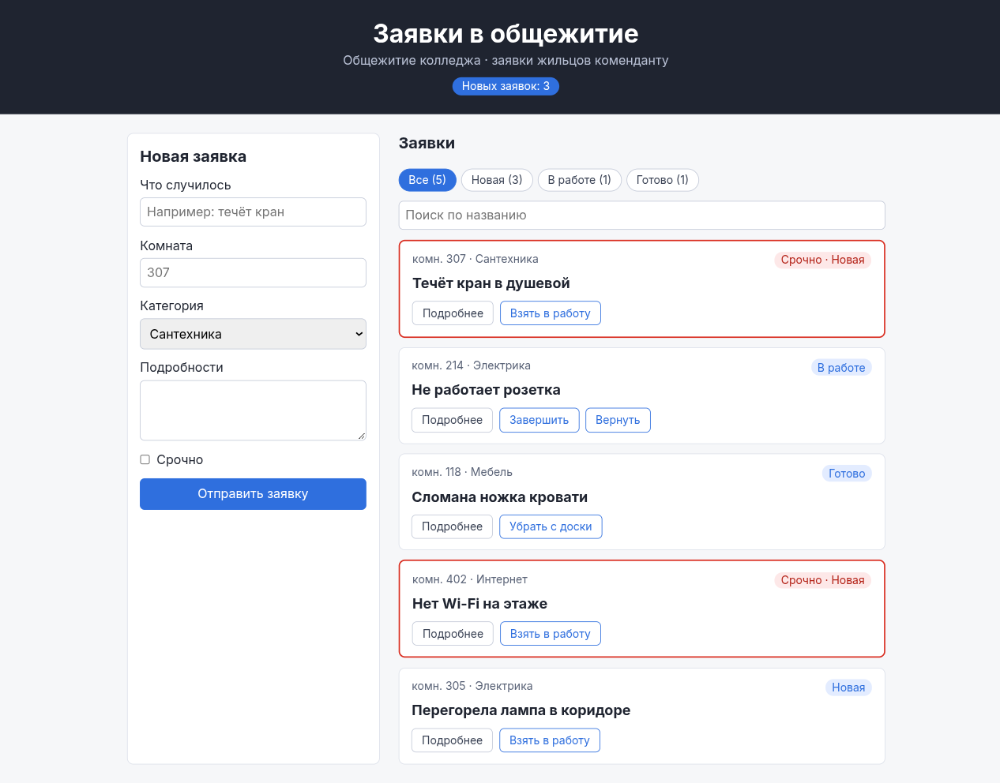

# Доска заявок

Доска заявок по главам справочника: React + TypeScript + Vite. Заявки хранятся в `localStorage`, доска показывает их список, фильтр по статусу и поиск. Новая заявка уходит в Telegram через n8n.

Вариант доски — «Общежитие». Проект модуля 1, собранный на её основе, лежит в [`projects/p1-obshchezhitie/`](../projects/p1-obshchezhitie/).



## Что умеет

- Новая заявка с полями «Что случилось», «Комната», «Категория», «Подробности» и отметкой «Срочно».
- Статусы «Новая» → «В работе» → «Готово», возврат в работу и удаление готовой заявки.
- Фильтр по статусу со счётчиками, поиск по названию, сброс фильтра клавишей Esc.
- Сохранение в `localStorage`: после перезагрузки страницы заявки остаются на месте.
- Уведомление о новой заявке в Telegram через вебхук n8n.

## Запуск

```bash
npm install
npm run dev
```

Приложение откроется на http://localhost:5173.

## Уведомления в Telegram

Доска отправляет заявку POST-запросом на вебхук n8n `http://localhost:5678/webhook/zayavka` (`src/notify.ts`). Стенд n8n и PocketBase, а также сценарий «Заявка → Telegram» лежат в общей папке [`avtomatizaciya/`](../avtomatizaciya/).

Без запущенного n8n доска работает, но сообщает, что уведомление не отправлено.

## Структура

```
src/
  App.tsx              — доска: список, фильтр, поиск, смена статусов, эффекты
  components/
    Header.tsx         — шапка со счётчиком новых заявок
    RequestForm.tsx    — форма новой заявки
    RequestCard.tsx    — карточка заявки
  requests.ts          — типы, начальные заявки, переходы статусов
  storage.ts           — сохранение в localStorage
  notify.ts            — отправка заявки в n8n
screenshots/           — снимки для README
```
